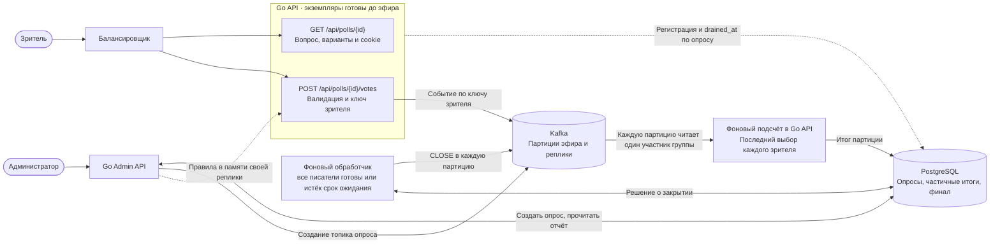

# Телеголосование за одну минуту

Во время эфира Go API проверяет голос и пишет его в Kafka. После эфира тот же сервис читает журнал, учитывает последний выбор каждого зрителя и сохраняет суммы в PostgreSQL. Так приём голоса по уже известному опросу обходится без запроса к базе.

## 1. Условия голосования

Один эфир — один вопрос. Варианты имеют постоянные ID. Для A/B и одиночного выбора зритель отмечает один вариант, для множественного — от заданного минимума до максимума. До закрытия можно заменить весь бюллетень.

При открытии вопроса API выдаёт браузеру случайную 128-битную cookie `televote_voter`. Она действует до закрытия на пути этого опроса. Ответ получает `Cache-Control: private, no-store`, иначе общий кэш мог бы раздать одну cookie разным людям. Две попытки с одной cookie считаются за один бюллетень. Поэтому зрители за одним Wi-Fi могут голосовать независимо, а очистка cookie или другой браузер позволяют проголосовать ещё раз. Две вкладки при одновременном первом открытии тоже могут получить разные cookie.

Администратор видит итог после подсчёта. В нём есть число бюллетеней и голоса по каждому варианту, в том числе нулевые. Процент — доля бюллетеней, в которых встретился вариант. При множественном выборе сумма процентов может превышать 100%, при пустом опросе процент равен `null`.

## 2. Профиль нагрузки

Все 100 млн зрителей голосуют за минуту. Каждый десятый отправляет голос повторно. Половину запросов ожидаем в первые 15 секунд, остальную половину — за следующие 45 секунд.

| За эфир | В среднем за секунду | Пик за секунду |
|---|---:|---:|
| 100 млн зрителей | 1,67 млн | 3,33 млн |
| 110 млн POST с учётом повторов | 1,83 млн | 3,67 млн |
| 100 млн GET, если каждый открыл вопрос один раз | 1,67 млн | 3,33 млн |

Если пики GET и POST совпадут, через балансировщик пройдёт до 7 млн запросов/с. При размере тела ответа GET в 2 000 байт только на передачу этих тел понадобится 53,3 Гбит/с. Ниже приведён расчёт для эфира. Локальные измерения сделаны на одном ноутбуке. [30 000 POST на одну реплику](reports/load-test.md) · [Голосование через две реплики](reports/replica-load.md)

## 3. Архитектура


Схема показывает размещение для эфира. В локальном Compose работают PostgreSQL и один брокер Kafka. Go-сервис запускается отдельно, у нового опроса по умолчанию четыре партиции с одной копией каждой. Для публичного сервиса предусмотрены HTTPS, балансировщик и брокеры в трёх зонах.

<details>
<summary>Редактируемая схема Mermaid</summary>



</details>

### Создание опроса

`POST /admin/polls` сохраняет черновик в PostgreSQL и создаёт отдельный топик Kafka. Затем одна SQL-транзакция привязывает UUID топика к опросу и публикует вопрос. После регистрации опроса на своей реплике API возвращает `201`. Администратор может передать UUID сам. Повтор того же запроса с этим ID продолжит прерванную публикацию, другие параметры с тем же ID дадут `400`. Без ID сервис создаст новый UUID.

При старте реплика загружает опубликованные опросы и проверяет соединение с Kafka. Во время работы она ищет опросы без финального результата раз в пять секунд. Если зритель пришёл раньше обновления, реплика загрузит вопрос по ID сразу. Одновременные запросы одного неизвестного ID объединяются. Пока PostgreSQL недоступен, зарегистрированная реплика продолжает принимать голоса по опросам в памяти. Публикации, загрузке новых вопросов и чтению отчётов нужна база. [HTTP-контракт](api/openapi.yaml)

### Запись голоса

`GET /api/polls/{id}` возвращает вопрос, варианты и время эфира. Браузер отправляет на `POST /api/polls/{id}/votes` cookie и JSON, например `{"choices":[2,4]}`. API проверяет окно голосования, ID, число вариантов и повторы внутри бюллетеня. Ошибки запроса дают `400` с пояснением, неизвестный опрос — `404`.

Топик опроса разделён на независимые журналы — партиции. У каждой своя нумерация записей (offset). Все API используют одну формулу.

```text
ключ = SHA-256(16 байт UUID опроса + 16 байт cookie)
партиция = первые 8 байт ключа как uint64 big-endian % число партиций
```

Число партиций фиксировано до финала. Поэтому даже при единогласном выборе A нагрузка распределяется по зрителям, а два ответа одного браузера остаются в одном журнале. При подсчёте ключ сравнивается целиком. Последним считается допустимый ответ с наибольшим offset до маркера закрытия. Если после B в журнал попал запоздалый повтор A, засчитается A. [Партиции Kafka](https://kafka.apache.org/41/getting-started/introduction/) · [Выбор партиции](https://kafka.apache.org/41/javadoc/org/apache/kafka/clients/producer/ProducerRecord.html)

Записи в Kafka отправляются пачками. В целевом кластере у партиции три копии в трёх зонах. С `acks=all` запись подтверждают все синхронные реплики, а `min.insync.replicas=2` требует минимум две. После потери одной зоны приём можно продолжить на двух синхронных копиях. При `acks=1` лидер мог бы подтвердить запись до копирования. [Настройка подтверждений](https://kafka.apache.org/41/configuration/producer-configs/#producerconfigs_acks) · [Минимум синхронных реплик](https://kafka.apache.org/41/configuration/topic-configs/#topicconfigs_min.insync.replicas)

После подтверждения Kafka API отвечает `202`. На каждый процесс выделен буфер отправки до 16 384 записей и 32 МиБ. Сервер ждёт до пяти секунд, даже если зритель закрыл вкладку. При переполнении или тайм-ауте возвращает `500`. Запись к этому времени могла состояться. Браузер может повторить POST с той же cookie, пока опрос открыт. Внутренние повторы отправителя обрабатывает идемпотентный producer Kafka. Два самостоятельных HTTP-запроса могут оставить две записи. Минимальный интервал обновления метаданных в producer — 50 мс, чтобы при смене лидера осталось время на повтор. [Разбор задержки на новом топике](reports/load-test.md) · [Семантика HTTP 202](https://www.rfc-editor.org/rfc/rfc9110.html#section-15.3.3)

### Почему Kafka и PostgreSQL

Прямая запись в SQL с уникальным ключом по опросу и зрителю позволила бы сразу подтвердить учтённый выбор. Тогда индекс и хранилище принимали бы весь пик POST. Для нашего отчёта допустим подсчёт после эфира, поэтому первичные голоса сохраняем в Kafka. В PostgreSQL записываем настройки, состояние закрытия и результаты.

Для точного счётчика в Redis пришлось бы атомарно учитывать повторы, делить популярный ответ по узлам и сохранять исходные заявки для пересчёта. С Kafka обработчик восстанавливает выбор из журнала и хранит в памяти только текущую партицию опроса. [Разбор вариантов записи](<reports/Выбор архитектуры записи голосов.md>) · [Redis Streams](https://redis.io/docs/latest/develop/data-types/streams/) · [Сохранность данных Redis](https://redis.io/docs/latest/operate/oss_and_stack/management/persistence/)

## 4. Где заканчивается минута

После чтения полного POST сервер регистрирует запрос и фиксирует `received_at`. Голос проходит проверку времени, если `opens_at ≤ received_at < closes_at`. Голос, принятый за 100 мс до закрытия, проходит проверку времени даже при более поздней записи в Kafka. Новый POST в момент `closes_at` уже получит `400`. Часы API и PostgreSQL должны быть согласованы.

1. Перед приёмом голосов процесс регистрирует свой UUID в `poll_writers` для этого опроса. После перезапуска UUID новый. Регистрация и решение о закрытии блокируют одну строку `poll_closures`, поэтому все реплики видят общий список писателей.
2. В `closes_at` каждая реплика прекращает приём и дожидается уже начатых запросов и ответов Kafka. Затем ставит `drained_at` в своей строке и сразу проверяет отметки. Если зарегистрирован хотя бы один писатель и все успели, PostgreSQL сохраняет решение `drained`. Последняя реплика может сразу отправить маркеры `CLOSE`.
3. Если кто-то ещё пишет, реплика ждёт по одному отменяемому таймеру до `closes_at + grace`. По умолчанию это пять секунд после эфира. Длительность ожидания (`grace_us`) хранится в PostgreSQL. У всех реплик, включая перезапущенные, срок один. Если список пуст или кто-то к этому моменту не отметился, живая реплика принимает решение `timeout` и начинает закрытие. При недоступности базы она повторит попытку позже.
4. После фиксации решения сервис отправляет `CLOSE` в каждую партицию без готового итога. Если реплика успела записать только часть маркеров или два процесса закрывали журнал одновременно, другой процесс сможет продолжить. Граница подсчёта — первый `CLOSE` в каждой партиции.

При штатной остановке реплика может отметить завершение своих отправок ещё до конца эфира. Если она зависла, маркер ставят после общего срока ожидания, как только доступна Kafka. При `timeout` даже подтверждённый `202` голос от отставшей реплики попадёт в итог только при записи **до первого маркера** своей партиции. [SQL для проверки закрытия и итогов](README.md#подсчёт-и-просмотр-результата)

## 5. Асинхронный подсчёт статистики

До финала административный отчёт показывает `scheduled`, `open` или `finalizing`. После закрытия реплики читают топик с общим `group.id` для опроса. Kafka назначает каждую партицию одному участнику группы. Участник читает свои партиции по очереди, процесс одновременно считает до четырёх опросов. [Как Kafka отдаёт записи](https://kafka.apache.org/41/design/design/#the-consumer)

Для каждой незавершённой партиции обработчик читает записи с offset 0 до первого `CLOSE`. Он проверяет ID опроса, время и варианты. Только допустимая запись заменяет в памяти весь предыдущий выбор зрителя. Например, для трёх заявок `X → A`, `X → B`, `Y → B` получится два бюллетеня за B. При множественном выборе замена `[A,B]` на `[B,C]` оставит один бюллетень с B и C.

На маркере сервис сохраняет в `poll_partition_results` его offset, количество разных ключей и суммы по вариантам. Ключ строки — `(poll_id, partition_id)`. Для пустой партиции суммы нулевые. Позицию `offset(CLOSE) + 1` сервис подтверждает Kafka только после записи итога в PostgreSQL. Если реплика упала раньше, новый владелец соберёт таблицу заново с начала партиции. Если строка уже сохранена, он пропустит повторный подсчёт.

Когда собраны все партиции от 0 до `P − 1`, один SQL-запрос проверяет комплектность, складывает суммы и сохраняет `poll_results`. Статус меняется на `final`. Повторная запись того же результата безопасна. При расхождении с сохранённой строкой обработчик возвращает ошибку. В отчёте нет истории отдельных зрителей. Доступ к исходному журналу в эксплуатации нужен сервисным ролям, а заголовки Cookie и Authorization следует исключить из логов балансировщика.

### Хранение журнала

Топик использует `cleanup.policy=delete` и наследует срок и предел объёма от брокера. Kafka может удалить старый сегмент раньше, чем до него дойдёт обработчик. Для эфира предлагаем 24 часа хранения и `retention.bytes=-1`. Если подсчёт затянулся, срок нужно продлить до удаления данных. При замене топика под прежним именем или утрате ещё не прочитанного диапазона сервис обнаружит ошибку. Опрос останется в `finalizing`. [Настройки хранения](https://kafka.apache.org/41/configuration/topic-configs/#topicconfigs_retention.bytes)

## 6. Вместимость и испытания

Для одного ответа `[1]` с UUID опроса и временем UTC с девятью знаками после секунды JSON занимает 111 байт, ключ — ещё 32. Это даёт 143 байта на запись, **524 МБ/с в пике и 15,73 ГБ за эфир**, до сжатия и служебных данных Kafka. При трёх копиях потребуется 47,19 ГБ. Таблица показывает нагрузку на одну партицию при равномерном распределении ключей.

| Партиций | Записей/с в пике | МБ/с в пике | Записей за эфир |
|---:|---:|---:|---:|
| 128 | 28 646 | 4,10 | 859 375 |
| **256** | **14 323** | **2,05** | **429 688** |
| 512 | 7 161 | 1,02 | 214 844 |

Начальная конфигурация для испытаний — 256 партиций (768 копий при RF=3). На одну копию партиции придётся 61,4 МБ за эфир. Диски нужны с запасом на другие эфиры, накладные расходы и восстановление. При нехватке места можно расширить том или перенести реплики партиций на другие брокеры, сохранив их номера. [Как выбирать число партиций](https://docs.confluent.io/kafka/operations-tools/partition-determination.html)

Проектная цель — показать финал за пять минут. Для этого нужно читать 367 тыс. событий/с. Если минуту оставить на закрытие, восстановление и публикацию, потребуется 458,4 тыс./с. При 256 партициях на одну приходится в среднем 390 625 уникальных зрителей. Только 32-байтовые ключи займут 12,5 МБ, к ним добавятся выбранные варианты и память Go-таблицы. При непрерывной работе растёт и кэш правил. Сейчас завершённые опросы остаются в памяти до перезапуска и снова загружаются при старте.

Для проверки этих оценок нужны отдельные генераторы, 100 млн GET и 110 млн POST за минуту. На трёх конфигурациях из таблицы стоит измерить фактические запросы/с, задержку подтверждения, сеть и диск брокеров, память обработчика и время до финала. Заключительная проверка — потеря одной зоны во время эфира и сверка итогов с известным выбором зрителей. Локальные прогоны подтверждают конкретные профили на одном брокере. [Исходный вывод](reports/load-test.txt) · [Опыт массовых опросов](<reports/Запись голосов в массовых опросах.md>) · [Журнал работы с ИИ](AI.md)
