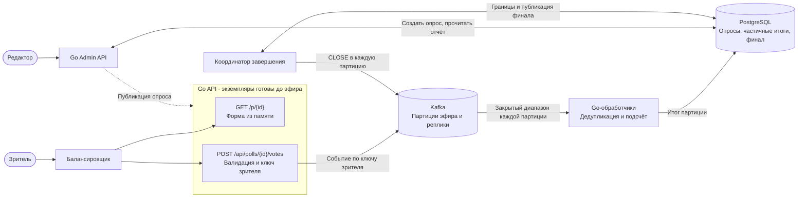

# Телеголосование за одну минуту

**Выбор для проекта — Go, Kafka и PostgreSQL.** Зритель открывает вопрос обычным GET и отправляет выбор отдельным POST. API подтверждает, что заявка записана в реплицированный журнал. После закрытия эфира обработчики читают зафиксированный диапазон журнала, учитывают первый допустимый голос каждого браузера и публикуют обезличенный итог. Через PostgreSQL проходят настройки опроса и результаты подсчёта. Так можно принять секундный пик, даже если подсчёт временно остановился. [Обоснование выбора](<reports/Выбор архитектуры записи голосов.md>)

## 1. Условия голосования

Один эфир содержит один вопрос, варианты со стабильными ID, минимальное и максимальное число выбранных вариантов, время открытия и закрытия в UTC. Для A/B выбирается один из двух вариантов. Для нескольких ответов бюллетень всё равно один. Финал в течение пяти минут после закрытия — цель проекта для испытаний. Редактору доступны число бюллетеней и отдельный счётчик каждого варианта, включая нулевые. Процент считается от числа бюллетеней, поэтому у вопроса с несколькими ответами сумма процентов может превысить 100%.

Участника определяет пара «ID конкретного опроса + случайная метка профиля браузера». Эту метку называем токеном. Перед первой отправкой браузер получает или создаёт для этого опроса случайный 128-битный токен в одной транзакции IndexedDB. После её завершения он передаёт токен в теле POST. Повтор и параллельная вкладка используют то же значение. Cookie могла бы передавать такую же метку автоматически. Два телефона за одним IP получают разные токены. Новый браузер или очистка его данных позволяют подать ещё один ответ. [Транзакции IndexedDB](https://www.w3.org/TR/IndexedDB-2/#transaction-scheduling)

## 2. Профиль нагрузки

| На один эфир | В среднем за 60 секунд | Пик ×2 |
|---|---:|---:|
| 100 млн уникальных бюллетеней | 1,67 млн/с | 3,33 млн/с |
| 110 млн POST, включая один повтор у каждого десятого зрителя | 1,83 млн/с | 3,67 млн/с |
| 100 млн GET при одном открытии формы на зрителя | 1,67 млн/с | 3,33 млн/с |

Для испытаний половина зрителей голосует за 15 секунд, остальные за 45 секунд. При совпадении пиков GET и POST балансировщик и Go API получают до 7 млн HTTP-запросов/с. Если сжатая форма занимает 2 000 байт, её выдача потребует около 53,3 Гбит/с на пике только для тела HTTP-ответов.

## 3. Архитектура

Редактируемая схема Mermaid

**Подготовка.** Для эфира заранее выделяется отдельный топик Kafka. В PostgreSQL сохраняются идентификатор поколения топика, фиксированный список партиций, их начальные позиции `S[p]`, версия правил и расписание. Число партиций и функция распределения ключей закреплены до финала. Экземпляр Go API входит в балансировку, когда загрузил неизменяемую конфигурацию, подготовил HTML и установил соединение с брокерами. При недоступности PostgreSQL уже опубликованный опрос продолжает принимать заявки. Создание новых опросов и чтение отчётов возобновятся после восстановления БД.

| Запрос | Контракт |
|---|---|
| `POST /admin/polls` | Создаёт и публикует опрос, возвращает ID и ссылку для QR. Доступ по административному секрету из окружения, в эксплуатации через HTTPS. |
| `GET /p/{id}` | Отдаёт вопрос и варианты из памяти Go API. Предпросмотр ссылки безопасен для счётчиков. |
| `POST /api/polls/{id}/votes` | Получает, например, `{"token":"<32 hex-символа>","choices":[2,4]}`. Проверяет, что опрос существует, токен имеет ожидаемый формат и длину, все ID принадлежат этому вопросу, их количество разрешено и ни один ID в этом бюллетене не указан дважды. Историю голосов зрителя проверит обработчик при подсчёте. До начала возвращает `409 not_open`, после закрытия — `410 closed`, неверный бюллетень — `422`. |
| `GET /admin/polls/{id}/results` | Авторизованный редактор получает `scheduled`, `open`, `finalizing` или `final`. Итоговые числа появляются после проверки всех партиций. |

**Проверка в API.** Каждый экземпляр Go API до эфира загружает опубликованные правила из PostgreSQL в локальную таблицу по ID опроса. При POST он находит правила в памяти, сравнивает текущее время с границами окна и сверяет выбранные варианты и их количество. Формат токена и повторяющиеся ID видны в самом запросе. Так проверка каждого бюллетеня обходится без сетевого обращения к Redis или PostgreSQL.

**Выбор партиции.** API вычисляет `voter_key = SHA-256(poll_uuid_bytes || token_bytes)` из двух полей фиксированной длины. Все экземпляры используют одно правило маршрутизации. Например, можно интерпретировать первые восемь байтов ключа как беззнаковое целое в порядке big-endian и взять остаток от деления на число партиций. Число партиций фиксируется до эфира по результатам нагрузочного теста. Зрители распределяются по партициям даже при единогласном выборе A. Повтор из того же профиля в том же опросе попадает в прежнюю партицию, в том числе при смене ответа на B. В событии сохраняются версия эфира, полный ключ для дедупликации и выбранные варианты.

**Подтверждение записи.** Для боевого кластера цель — продолжить приём после отказа одной зоны и по-прежнему иметь две копии каждой подтверждённой заявки. Для этого размещаем три реплики каждой партиции в трёх зонах. Producer объединяет записи в пакеты. С `acks=all` он ждёт все текущие синхронные реплики, а `min.insync.replicas=2` задаёт нижнюю границу. Когда синхронны три, нужны все три. После потери одной зоны и выбора лидера при необходимости оставшиеся две могут подтверждать вдвоём. С одной синхронной репликой API не выдаёт `202`. При `acks=1` лидер мог бы подтвердить запись и упасть до её копирования. API отправляет `202` со смыслом «заявка сохранена для проверки» только после подтверждения Kafka. Идемпотентность отправителя Kafka защищает от его внутренних повторов. Новый HTTP-запрос от браузера может создать ещё одно событие. [Настройки acks](https://kafka.apache.org/41/configuration/producer-configs/#producerconfigs_acks) · [Минимум синхронных реплик](https://kafka.apache.org/41/configuration/topic-configs/#topicconfigs_min.insync.replicas) · [Семантика HTTP 202](https://www.rfc-editor.org/rfc/rfc9110.html#section-15.3.3)

У API ограничены буферы и время ожидания. При перегрузке или истечении срока ожидания подтверждения — `503`. Исход при тайм-ауте может быть неизвестен. Пока окно открыто, клиент повторяет прежний токен и выбор с ограничением попыток и случайной задержкой. После закрытия `410` описывает текущую отправку. Первоначальный запрос мог попасть в журнал. Например, зритель выбрал A, Kafka записала заявку, но связь прервалась до получения браузером ответа. Повтор с прежним токеном и выбором может дать вторую запись. При подсчёте первая допустимая запись добавит один голос за A, вторая даст нулевую прибавку. Персональный статус отдельного бюллетеня в этой версии не хранится.

## 4. Где заканчивается минута

В окончательный подсчёт входит допустимое событие, добавленное брокером в интервале `[opens_at, closes_at)` до маркера закрытия своей партиции. В топике включён `message.timestamp.type=LogAppendTime`: обработчик использует время добавления пакета брокером. Получение HTTP-ответа может произойти позже. Запрос, начатый у зрителя до дедлайна, может достигнуть журнала уже после него. Расхождение часов брокеров и API проверяется перед эфиром и отслеживается при переключении лидера. [Время записи в Kafka](https://kafka.apache.org/41/configuration/topic-configs/#topicconfigs_message.timestamp.type)

По дедлайну координатор отправляет служебный маркер `CLOSE` в каждую партицию и при необходимости повторяет отправку. Обычный клиент через API может опубликовать только валидированный бюллетень. Для партиции `p` границей `E[p]` служит позиция **первого** маркера текущего поколения, чья брокерская метка достигла `closes_at`. Слишком ранний маркер пропускают и посылают новый. При восстановлении границу находят чтением журнала. Добавленный позднее дубликат её не сдвигает. Это даёт конкретный конечный диапазон даже для пустой партиции.

## 5. Как получить воспроизводимый итог

Запись заявки в журнал подтверждается в том же HTTP-запросе. Подсчёт предлагаем выполнять отдельно, поскольку редактору нужен финальный отчёт, а окно для подачи голосов длится всего минуту. Полный проход после закрытия позволяет один раз прочитать фиксированный набор событий. Если в будущем ведущему понадобятся промежуточные результаты, обработчики смогут читать журнал уже во время эфира и публиковать предварительные числа. Для окончательного итога всё равно потребуется дождаться границ всех партиций.

1. Обработчик последовательно читает записи диапазона `[S[p], E[p])`, проверяет время брокера, поколение и правила. Для допустимого события он проверяет полный ключ в точном множестве уже учтённых зрителей этой партиции. При первом появлении добавляет ключ, увеличивает число бюллетеней и счётчики выбранных вариантов. При двух разных ответах выигрывает допустимая запись с меньшим offset.
2. После полного прохода обработчик сохраняет в PostgreSQL неизменяемый итог и его границы по уникальному ключу «эфир, поколение, партиция, версия алгоритма». Конкурирующий обработчик может сохранить тот же итог один раз. При конфликте он сверяет границы и числа с существующей записью. После аварии достаточно заново прочитать с `S[p]` каждую незавершённую партицию. Позиция группы Kafka сама по себе разрешения опубликовать результат не даёт.
3. Координатор одной SQL-транзакцией проверяет точное совпадение набора частичных итогов с манифестом, складывает их и фиксирует `final`. Партиция без голосов даёт явный ноль. Пока маркер или итог отсутствует, отчёт остаётся в `finalizing`. При утрате диапазона или противоречии частичных итогов оператор видит причину и партицию. Публикация финала заблокирована до восстановления данных.

Журнал временно связывает псевдоним с выбором. Доступ к нему ограничен сервисными ролями. В HTTP-логах и трассировке исключаем токен, выбор и заголовок авторизации. Для исходных событий предлагаем 24 часа хранения с запасом на восстановление, `cleanup.policy=delete` и контроль свободного места. Kafka применяет лимиты по времени и размеру независимо от статуса опроса. При затянувшемся восстановлении нужно успеть продлить хранение до удаления сегментов. В PostgreSQL остаются агрегаты. [Политики хранения Kafka](https://kafka.apache.org/41/configuration/topic-configs/#topicconfigs_retention.ms)

## 6. Вместимость и испытания

При условных 128 байтах на событие один эфир даёт **14,08 ГБ** полезных данных, при трёх копиях — **42,24 ГБ** до учёта сжатия и накладных расходов. Пик входа в Kafka — около 469 МБ/с полезных данных. Если подсчёт целиком начнётся после эфира, за 300 секунд нужно прочесть в среднем **367 тыс. событий/с**. Полные 32-байтовые ключи для 100 млн зрителей займут суммарно 3,2 ГБ до учёта таблиц хеширования. Во время испытаний измеряем память наиболее заполненной партиции и время её повторного прохода. Число партиций выбираем по большему из требований к записи и к параллельному чтению с запасом на отказ. [Подготовка сервиса к пику](https://sre.google/sre-book/reliable-product-launches/)

Локальный срез проекта — один процесс Go с публичными и административными обработчиками, координатором и задачей подсчёта, один Kafka-брокер и одна PostgreSQL в Docker Compose. Для демонстрационного кластера используются RF=1 и `min.insync.replicas=1`. На нём можно показать порядок этапов и восстановление обработчика. Для проверки отказа брокера нужен отдельный стенд с репликацией.

Испытания покрывают потерю HTTP-ответа после записи, дубль с изменённым выбором, общий IP двух зрителей, запрос на границе минуты, рестарт координатора, повтор маркера, пустую партицию, частично сохранённый результат и потерю брокера. В полном прогоне независимый генератор подаёт 110 млн POST от 100 млн ключей на один опрос, параллельно открывает формы и сверяет исходные ключи и выборы с журналом. Для контрольного A/B ожидаем в админке ровно 100 млн бюллетеней, 90 млн A и 10 млн B.

**Почему этот вариант.** Прямой SQL INSERT удобен, если зрителю нужно сразу подтвердить учтённый выбор. При доступном окне на подсчёт журнал отделяет входной пик от работы уникального индекса. Для закрытого эфира достаточно точного прохода по партициям с восстановлением из журнала. Расчёты выше задают требования к будущему стенду. [Практика телешоу](<reports/Запись голосов в массовых опросах.md>) · [Журнал работы с ИИ](AI.md)
