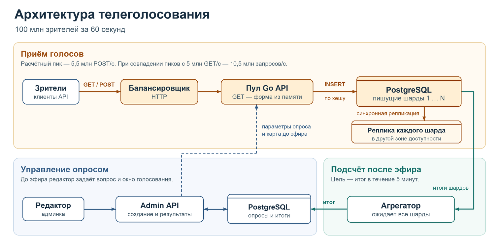
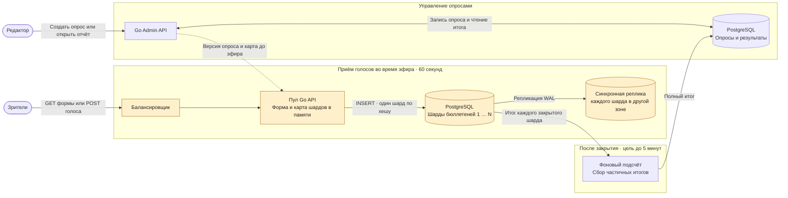

# Телеголосование за одну минуту

Для тестового я бы выбрал **один Go-сервис и PostgreSQL**. Зритель получает «голос учтён» после фиксации уникального бюллетеня. Администратор получает точный итог после завершения эфира. Локально весь путь помещается в одну БД. Для национального эфира единицей масштабирования становится группа зрителей внутри одного опроса. Пропускную способность этой схемы предстоит измерить.

## 1. Что обещаем зрителю и редактору

| Вопрос | Рабочее решение |
|---|---|
| Что создаёт редактор? | Один эфир, один вопрос, набор вариантов, минимум и максимум выбранных вариантов, время открытия и закрытия в UTC. При A/B вариантов два и выбрать можно один. Та же модель поддерживает выбор одного или нескольких ответов и шкалу с конечным набором значений. Свободный текст потребует отдельного решения для модерации и представления результатов. |
| Кто может проголосовать? | Любой зритель по QR или короткой ссылке. Один профиль браузера с сохранёнными данными может подать один бюллетень на эфир. У двух зрителей за одним внешним IP отдельные голоса. Один общий браузер в семье даёт один голос. |
| Какой из двух ответов принимаем? | Первый успешно записанный. Если зритель одновременно отправит из двух вкладок разные ответы, порядок определит запись в хранилище. Принятый ответ изменить нельзя. |
| Когда открыт приём? | Опубликованное окно `[opens_at, closes_at)`. Решает время на сервере хранения в момент допуска. Нажатие в 59,9 с может опоздать из-за сети. Повторный телепоказ получает собственное окно и ссылку. |
| Когда готовы цифры? | Для задания предполагаем, что редактору достаточно финального отчёта. В качестве цели для испытаний берём пять минут после эфира. Результат содержит число бюллетеней и число выборов каждого варианта, включая нули. |

До реализации с заказчиком важнее всего сверить три решения: нужен ли счётчик прямо в эфире, входят ли текстовые ответы и где проходит граница минуты для зрителя с задержкой трансляции. Они меняют API, хранение и стоимость решения.

## 2. Сколько трафика придёт

**Целевой эфир — 100 000 000 зрителей, 100 000 000 разных валидных бюллетеней за 60 секунд и ровно 100 000 000 учтённых в финале.** Для модели анонимного голосования каждому зрителю соответствует свой токен в этом опросе. Повторные отправки дают дополнительную нагрузку. Клиент с ID опроса, ID выбранных вариантов и своим токеном может сразу отправить POST. В браузерном сценарии каждый зритель сначала открывает форму по QR. Тогда на Go-сервис приходится 100 млн GET страницы и как минимум 100 млн POST голоса за эфир.

| Профиль одного эфира | Новых бюллетеней/с | POST/с при одном дополнительном запросе у 10% зрителей |
|---|---:|---:|
| Равномерно, 100 млн за 60 с | 1,67 млн | 1,83 млн |
| Сценарий пика, 50 млн за самые загруженные 10 с | 5,00 млн | 5,50 млн |
| Оставшиеся 50 млн за 50 с | 1,00 млн | 1,10 млн |

В сценарии пика за первые 10 секунд приходят 50 млн новых бюллетеней и 5 млн повторов, за следующие 50 секунд — ещё столько же. Итого **110 млн POST и 100 млн бюллетеней в результате**. При одном GET страницы на зрителя это 210 млн запросов к Go-сервису за эфир, в среднем 3,5 млн/с. Если пик открытий страницы (5 млн GET/с) совпадёт с пиком отправок, балансировщик и пул API получат 10,5 млн запросов/с. Для GET экземпляр API отдаёт заранее подготовленный HTML из памяти. Шарды обслуживают запросы записи и проверку повторов.

Пик и доля повторов — допущения для испытаний. В таблице повторы распределены пропорционально новым запросам. После сетевого сбоя они могут прийти одной волной. При условных 500 байтах на POST пиковые 5,5 млн попыток/с требуют **22 Гбит/с** на входе только для голосования. При раздаче формы стоит отдельно измерить исходящую полосу: например, при размере сжатой страницы 2 000 байт и пике 5 млн GET/с только тело HTML занимает ещё 80 Гбит/с на выходе. Отдельно учитываются заголовки, транспорт и внутренняя сеть. Для оценки хранения даже один 32-байтовый хеш на каждый бюллетень даёт 3,2 ГБ за эфир. К нему добавятся варианты, строки и индекс БД, WAL, реплики и резервные копии.

## 3. Архитектура сервиса

Схема показывает компоненты для национального эфира. Выделенный путь записи рассчитан на сценарий, в котором 100 млн зрителей голосуют за минуту, а пиковая нагрузка с повторами достигает 5,5 млн POST/с. Для локальной демонстрации публичный API, Admin API и задача подсчёта работают в одном процессе Go, все таблицы находятся в одной базе PostgreSQL.

Открыть схему в Mermaid

**Один голос — один пишущий шард.** Балансировщик выбирает один из доступных экземпляров API. Хеш ключа зрителя определяет шард, поэтому повтор попадёт в ту же базу через любой экземпляр API. Подтверждение нового голоса ждёт записи на primary и его синхронной реплике. При подготовке итогового отчёта нужны данные со всех шардов.

**Публикация.** Сервис проверяет варианты и расписание, фиксирует версию опроса и раскладывает её вместе с картой шардов до эфира. Ссылку для показа можно выдавать после готовности всех назначенных шардов и публикации страницы. Вопрос и окно неизменны после публикации. До эфира каждый экземпляр публичного API загружает параметры опроса, готовит общую HTML-страницу и открывает пул соединений с БД. Балансировщик направляет трафик на готовые экземпляры. Приём уже опубликованного опроса не обращается в центральную админскую БД.

**Открытие ссылки.** По QR браузер вызывает `GET /p/{id}`. Go-сервис возвращает общий HTML из памяти экземпляра. Предпросмотр ссылки в мессенджере безопасен. Перед отправкой JS получает или создаёт случайный 128-битный токен для данного эфира в одной `readwrite`-транзакции IndexedDB. Обе вкладки одного origin прочитают один ключ, если дождаться завершения транзакции перед POST. Идентификатор не попадает в URL или кэшируемый ответ. При недоступном хранилище форма просит открыть ссылку в браузере с доступным локальным хранилищем. Такой выбор экономит ещё 100 млн вызовов отдельной ручки выдачи токенов. [Планирование транзакций IndexedDB](https://www.w3.org/TR/IndexedDB-2/#transaction-scheduling)

**Отправка.** Ручку `POST /api/polls/{id}/votes` можно вызвать напрямую. Предварительный GET и серверная сессия для этого не требуются. API принимает токен и список ID. Проверяет формат, размер, принадлежность вариантов опубликованному вопросу, границы количества и отсутствие повторов. Сортирует ID, поэтому `[2,1]` и `[1,2]` дают один ответ. Вычисляет `voter_key = SHA-256(poll_uuid_bytes || token_bytes)` из двух полей фиксированной длины. Все копии API направляют ключ в один физический шард по зафиксированной карте. Там хранится одна строка на бюллетень с первичным ключом `(poll_id, voter_key)` и выбранными вариантами. Строка одновременно служит голосом и отметкой о его приёме.

**Подтверждение.** В открытом окне транзакция выполняет `INSERT ... ON CONFLICT (poll_id, voter_key) DO NOTHING RETURNING ...`. Успешный COMMIT новой строки даёт `201 counted`. При конфликте следующий SQL-запрос в режиме `READ COMMITTED` читает победившую строку на том же primary. Равный набор вариантов даёт `200 already_counted`, другой — `409 already_voted`. Отдельный запрос важен при гонке с ещё не зафиксированной строкой другой транзакции. Тайм-аут при COMMIT оставляет исход неизвестным. Клиент повторяет запрос с прежним токеном и выбором, сервер снова определяет исход по записи. [PostgreSQL INSERT](https://www.postgresql.org/docs/current/sql-insert.html) · [Видимость конкурентных записей](https://www.postgresql.org/docs/current/transaction-iso.html#XACT-READ-COMMITTED)

### Контракт API для первой версии

| Запрос | Ответ |
|---|---|
| `POST /admin/polls` | Авторизованный редактор задаёт вопрос, варианты и окно. После подготовки получает `201`, ID и публичный URL. |
| `GET /p/{id}` | Публичный Go API отдаёт готовую форму из памяти. Голосование требует явной отправки. |
| `POST /api/polls/{id}/votes` | Тело, например `{"token":"<32 hex-символа>","choices":[2,4]}`. Исходы записи описаны выше. До начала — `409 not_open`, после закрытия для нового голоса — `410 closed`, неверный бюллетень — `422`. При недоступности хранилища или исчерпании ограниченного пула — `503`. |
| `GET /admin/polls/{id}/results` | Состояние `scheduled`, `open`, `finalizing` или `final`. В финале отдаём `total_ballots` и число голосов по каждому варианту. Обе админские ручки требуют Bearer-секрет из окружения, в эксплуатации — HTTPS. |

Форма в браузере отправляет POST на тот же origin. Публичная ручка применяет одинаковые правила к браузерным запросам и другим HTTP-клиентам. Значение токена, тело бюллетеня и заголовок авторизации исключаются из журналов приложения, прокси и трассировщика. Административный интерфейс выдаёт только агрегаты. Во время обработки хранилище всё же содержит связь псевдонима с выбором. Предлагаемый срок для повторов — 24 часа после публикации итога, затем удаляем исходные бюллетени, оставляем отчёт и возвращаем `410` для поздних попыток. Доступ и срок жизни копий и WAL настраиваются отдельно. Очистка данных браузера или другое устройство дают новый токен. Привязка к IP лишила бы голоса часть зрителей за операторским NAT. [RFC 6888, общий адрес у нескольких абонентов](https://www.rfc-editor.org/rfc/rfc6888.html#section-1)

## 4. Последняя миллисекунда и окончательный результат

Пусть первый запрос допущен в `12:00:59.999`, его COMMIT произошёл в `12:01:00.004`, а ответ потерялся. В момент закрытия в таблице ещё могло быть ноль видимых голосов. Контракт требует, чтобы отчёт включил этот бюллетень, а повтор от зрителя вернул `already_counted`.

1. В начале записи шард берёт разделяемую транзакционную advisory-блокировку для эфира. После захвата читает локальный флаг закрытия и один раз берёт `clock_timestamp()` для проверки окна. Уже допущенная транзакция удерживает блокировку до завершения. Задержка в очереди до допуска входит в минуту.
2. По наступлении дедлайна на часах шарда финализатор берёт исключительную блокировку по тому же ключу, дожидается начатых записей и фиксирует `sealed`. Многие зрители могут писать одновременно при разделяемой блокировке. Мониторинг расхождения часов шардов нужен для общей границы эфира. [Блокировки PostgreSQL](https://www.postgresql.org/docs/current/functions-admin.html#FUNCTIONS-ADVISORY-LOCKS) · [Семантика clock_timestamp](https://www.postgresql.org/docs/current/functions-datetime.html#FUNCTIONS-DATETIME-CURRENT)
3. Поздний повтор сначала ищет зафиксированный бюллетень. Если записи ещё не видно и шард пока открыт для завершения транзакций, запрос освобождает свою разделяемую блокировку, инициирует или ждёт закрытия и перечитывает запись в свежем снимке. Так он может различить прежний голос и опоздавшего зрителя. При тайм-ауте ожидания возвращает `503` с возможностью повтора.
4. После `sealed` в свежем снимке каждый шард считает `count(*)` бюллетеней и отдельно разворачивает массив вариантов для подсчёта по ID. Пустой шард присылает нули. Итог шарда сохраняется по уникальному `(poll_id, shard_id)` замещением. Повтор подсчёта после перезапуска безопасен.
5. Координатор сверяет все ID шардов с картой именно этого эфира и одной транзакцией публикует сумму и `final`. Если один шард недоступен, редактор видит `finalizing` и число готовых шардов. После восстановления подсчёт продолжается. Очистка исходных записей начинается только после сохранения полного итога и истечения срока повторов.

Для multi-select процент варианта равен числу выбравших его бюллетеней, делённому на `total_ballots`. Семь ответов A и шесть B у десяти зрителей дают **70% и 60%**. Для пустого опроса отображаем ноль голосов и прочерк вместо процента.

## 5. Цена решения и граница его применения

**Локальная реализация.** Один бинарник Go с HTTP API и фоновой задачей закрытия, один PostgreSQL в Docker Compose, одна HTML-форма. Go даёт HTTP-сервер и простой запуск одним бинарником. Основная причина выбора PostgreSQL — возможность выразить дедупликацию, сохранение выбора и исход для повторного запроса одной транзакцией. Группировка после эфира убирает из пути записи общий счётчик самого популярного варианта.

**Схема для эфира.** Один регион с несколькими зонами доступности, горизонтальный пул API за балансировщиком и независимые пишущие шарды. Хеш `voter_key` определяет виртуальную корзину, а заранее опубликованная карта назначает корзину шарду. Шардирование только по `poll_id` отправило бы весь национальный эфир на один узел. Карту фиксируем до истечения срока повторов. Передача роли primary в пределах шарда требует отключить старый primary от записи и продвигать только реплику, сохранившую подтверждённые записи. В эксплуатации COMMIT ждёт записи WAL на синхронной реплике в другой зоне. При потере доступной синхронной реплики запрос может получить тайм-аут. Перенаправление на произвольный шард нарушило бы уникальность. [Синхронная репликация PostgreSQL](https://www.postgresql.org/docs/current/warm-standby.html#SYNCHRONOUS-REPLICATION)

**Что произойдёт с повтором при потере узла?** В промышленной схеме при конфликте одного SELECT на primary может оказаться недостаточно. После перезапуска primary способен увидеть локальный COMMIT, подтверждения которого от реплики ещё не было. Поэтому для ответа о ранее записанном бюллетене проверяем, что он виден и на назначенной синхронной реплике. Если исход пока неизвестен, клиент получает `503` и повторяет с тем же токеном, с ограничением числа попыток и случайной задержкой. Нагрузочный профиль включает стоимость этой проверки. [Поведение при отказе primary](https://www.postgresql.org/docs/current/warm-standby.html#SYNCHRONOUS-REPLICATION)

**Сколько потребуется узлов?** Пусть `q` — измеренная пропускная способность одного пишущего шарда для нашего SQL, состава повторов и синхронной реплики при целевой p99. Для примера целимся в p99 ответа API до 300 мс и планируем загрузку до 70% от измеренного предела. Стартовая оценка числа primary — `ceil(5 500 000 / (0,70 × q))`. Даже если стенд покажет 20 тыс. попыток/с на шард, получится **393 primary плюс реплики**. Это иллюстрация стоимости выбранной гарантии. До выделения парка нужны замеры WAL, задержки синхронной репликации, конкуренции на блокировке эфира, сетевого тракта и испытание группы шардов при отказе зоны.

**Когда выбрать Kafka.** Если редакции подходит ответ зрителю «получено в обработку», а измеренный парк SQL для пика слишком дорог, выбираем другой контракт. API пишет бюллетень с однократно проверенным временем допуска в реплицированный журнал и отвечает `202` после подтверждения брокеров. Ключ партиции включает эфир и псевдоним зрителя. Отложенный потребитель дедуплицирует и считает в порядке записей одной партиции, повторная обработка идемпотентна. На пять минут обработки после эфира хватило бы в среднем около **333 тыс. уникальных бюллетеней/с**, но брокерам всё ещё надо принять весь пик. Для публикации финала нужен протокол завершения всех допущенных записей и достижения границы каждой партиции конкретного эфира. У журнала есть явная выгода — пережить остановку подсчёта во время показа. У прямой записи есть явная выгода — сразу узнать, принят ли конкретный выбор зрителя.

## 6. Что продемонстрировать при сдаче

В пределах 2–3 часов приоритет у сквозного сценария, параллельной отправки одного бюллетеня, корректного закрытия и воспроизводимого локального запуска. Для оценки национального масштаба отдельно потребуется стенд с несколькими шардами, репликацией и генераторами в независимых узлах.

| Испытание | Признак корректной реализации |
|---|---|
| Полный путь | Одной командой поднимается Compose. Редактор создаёт короткий опрос, два браузера голосуют с одного IP, после закрытия редактор видит два бюллетеня. Админские запросы без секрета отклоняются. |
| Один ключ, две копии API | Сотня конкурентных одинаковых отправок даёт одну запись. Если одновременно поданы A и B, выигрывает ровно один. Новая вкладка и обновление страницы сохраняют ключ. |
| Граница окна и потеря ответа | Тест управляемо задерживает COMMIT допущенного запроса до закрытия. Финализатор ждёт, ретрай корректно узнаёт прежний выбор, новый поздний токен получает `410`. |
| Сбой | Остановить API после COMMIT до записи HTTP-ответа, перезапустить и повторить POST. Прервать сбор частичных итогов, повторить его и сравнить с подсчётом бюллетеней. |
| Состав ответа | Пустой опрос, A/B, разный порядок при multi-select, повтор варианта, вариант из другого опроса и неверное число вариантов. Проверить нулевые варианты и знаменатель процентов. |
| Нагрузка | k6 с открытой моделью поступления. Один горячий опрос, 90% выбрали A, новый токен на зрителя и прежний токен на ретрай. Запустить профиль прямых POST. Затем добавить независимый поток GET с совпадающим пиком и проверить задержку записи, пропускную способность и исходящий трафик раздачи HTML. |

**Критерий приёмки на полной аудитории.** Для одного A/B-опроса генераторы получают непересекающиеся диапазоны номеров зрителей от 0 до 99 999 999. Каждому номеру соответствует уникальный тестовый токен. Номера с последней цифрой 9 выбирают B, остальные — A. Для каждого десятого номера генератор дополнительно посылает тот же бюллетень. За минуту на входе должны оказаться все 100 млн исходных запросов и 10 млн запланированных повторов. Пропущенная генератором отправка или зритель, потерявший возможность проголосовать из-за перегрузки до закрытия окна, означает провал испытания.

На стенде перед удалением исходных строк сверяем набор пар «токен в виде хеша, выбор» с ожидаемым набором генератора. Требуем ноль пропущенных, лишних и неверно записанных бюллетеней. Админский API должен вернуть `final`, `total_ballots = 100 000 000`, `A = 90 000 000`, `B = 10 000 000`. Повторы для выяснения исхода тайм-аута отмечаем отдельно от 110 млн запланированных POST. В реальном эфире число в отчёте вычисляется из записей всех закрытых шардов. Значение 100 млн известно заранее только для контрольного сценария.

Для отдельного прогона с несколькими вариантами задаём 70 млн зрителей с ответом «только A», 20 млн с ответом «A и B» и 10 млн с ответом «только B». Ожидаем те же **100 млн бюллетеней**, 90 млн выборов A и 30 млн выборов B.

В отчёте нагрузочного теста фиксируем оборудование, топологию, профиль, запланированные и фактически отправленные попытки, `dropped_iterations`, ответы по типам, тайм-ауты, p95/p99 и время готовности итога. Сверяем результат по каждому варианту с независимым набором ожидаемых бюллетеней генератора. Для запросов с потерянным ответом устанавливаем исход повтором. Именно эту сверку стоит показать на защите: быстрые HTTP-ответы сами по себе не обнаружат потерянный или удвоенный голос. [Открытая модель k6](https://grafana.com/docs/k6/latest/using-k6/scenarios/concepts/open-vs-closed/) · [Пропущенные итерации](https://grafana.com/docs/k6/latest/using-k6/scenarios/concepts/dropped-iterations/)

История запросов к ИИ и принятых проектных решений сохранена в [журнале работы](AI.md).
