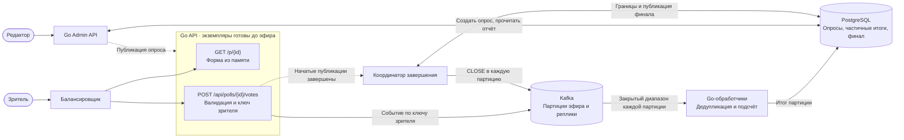

# Телеголосование за одну минуту

**Выбор для проекта — Go, Kafka и PostgreSQL.** Зритель открывает вопрос обычным GET и отправляет выбор отдельным POST. API подтверждает, что заявка записана в реплицированный журнал. После закрытия эфира обработчики читают зафиксированный диапазон журнала, учитывают первый допустимый голос каждого браузера и публикуют обезличенный итог. Через PostgreSQL проходят настройки опроса и результаты подсчёта. Так можно принять секундный пик, даже если подсчёт временно остановился. [Обоснование выбора](<reports/Выбор архитектуры записи голосов.md>)

## 1. Условия голосования

Один эфир содержит один вопрос с выбором из заданных вариантов. Поддерживаем A/B, выбор одного варианта из списка и множественный выбор. Варианты имеют стабильные ID, у вопроса заданы минимальное и максимальное число выбранных вариантов, время открытия и закрытия в UTC. Для нескольких ответов бюллетень всё равно один. Редактор получает один финальный отчёт после закрытия. Публикацию в течение пяти минут проверяем на нагрузочном испытании. В отчёте видны число бюллетеней и отдельный счётчик каждого варианта, включая нулевые. Процент считается от числа бюллетеней, поэтому у вопроса с несколькими ответами сумма процентов может превысить 100%.

Участника определяет пара «ID конкретного опроса + случайная метка профиля браузера». Эту метку называем токеном. Перед первой отправкой браузер получает или создаёт для этого опроса случайный 128-битный токен в одной транзакции IndexedDB. После её завершения он передаёт токен в теле POST. Повтор и параллельная вкладка используют то же значение. Cookie могла бы передавать такую же метку автоматически. Два телефона за одним IP получают разные токены. Новый браузер или очистка его данных позволяют подать ещё один ответ. [Транзакции IndexedDB](https://www.w3.org/TR/IndexedDB-2/#transaction-scheduling)

## 2. Профиль нагрузки

| На один эфир | В среднем за 60 секунд | Пик ×2 |
|---|---:|---:|
| 100 млн уникальных бюллетеней | 1,67 млн/с | 3,33 млн/с |
| 110 млн POST, включая один повтор у каждого десятого зрителя | 1,83 млн/с | 3,67 млн/с |
| 100 млн GET при одном открытии формы на зрителя | 1,67 млн/с | 3,33 млн/с |

Для испытаний половина зрителей голосует за 15 секунд, остальные за 45 секунд. При совпадении пиков GET и POST балансировщик и Go API получают до 7 млн HTTP-запросов/с. Если сжатая форма занимает 2 000 байт, её выдача потребует около 53,3 Гбит/с на пике только для тела HTTP-ответов.

## 3. Архитектура

Редактируемая схема Mermaid

**Подготовка.** Для эфира заранее выделяется отдельный топик Kafka. В PostgreSQL сохраняются идентификатор поколения топика, фиксированный список партиций, их начальные позиции `S[p]`, версия правил и расписание. Число партиций и функция распределения ключей закреплены до финала. Экземпляр Go API входит в балансировку, когда загрузил неизменяемую конфигурацию, подготовил HTML и установил соединение с брокерами. При недоступности PostgreSQL уже опубликованный опрос продолжает принимать заявки. Создание новых опросов и чтение отчётов возобновятся после восстановления БД.

| Запрос | Контракт |
|---|---|
| `POST /admin/polls` | Создаёт и публикует опрос, возвращает ID и ссылку для QR. Доступ по административному секрету из окружения, в эксплуатации через HTTPS. |
| `GET /p/{id}` | Отдаёт вопрос и варианты из памяти Go API. Предпросмотр ссылки безопасен для счётчиков. |
| `POST /api/polls/{id}/votes` | Получает, например, `{"token":"<32 hex-символа>","choices":[2,4]}`. Проверяет, что опрос существует, токен имеет ожидаемый формат и длину, все ID принадлежат этому вопросу, их количество разрешено и ни один ID в этом бюллетене не указан дважды. Историю голосов зрителя проверит обработчик при подсчёте. До начала возвращает `409 not_open`, после закрытия — `410 closed`, неверный бюллетень — `422`. |
| `GET /admin/polls/{id}/results` | Авторизованный редактор получает `scheduled`, `open`, `finalizing` или `final`. Итоговые числа появляются после проверки всех партиций. |

**Проверка в API.** Каждый экземпляр Go API до эфира загружает опубликованные правила из PostgreSQL в локальную таблицу по ID опроса. Прочитав тело POST целиком, он один раз фиксирует серверное время `received_at` при регистрации запроса. API сравнивает эту метку с границами окна и сверяет выбранные варианты и их количество. Формат токена и повторяющиеся ID видны в самом запросе. Так проверка каждого бюллетеня обходится без сетевого обращения к Redis или PostgreSQL.

**Как устроен журнал.** Для голосов одного эфира создаём именованный журнал Kafka — топик. Он разделён на `P` партиций. В каждой новые записи добавляются в конец и получают позицию `offset`. Порядок определён внутри партиции. Разные партиции могут обслуживать разные серверы Kafka (брокеры), поэтому запись и чтение идут параллельно. После чтения запись остаётся доступной в пределах срока хранения. [Основы Kafka](https://kafka.apache.org/41/getting-started/introduction/)

У каждой партиции своя нумерация. В одном топике `(партиция 17, offset 40)` и `(партиция 23, offset 40)` — адреса двух разных записей. Обработчик знает номер назначенной партиции и следующую позицию чтения. Он запрашивает у брокера пачку с этой позиции. Получив из партиции №17 записи 40 и 41, он продолжает с 42. Чтение партиции №23 продолжается с её собственной позиции. Для итоговой суммы достаточно порядка попыток каждого зрителя внутри его партиции. [Как Kafka обслуживает запросы чтения](https://kafka.apache.org/41/design/design/#the-consumer)

**Выбор партиции.** Отправитель может передать клиенту Kafka явный номер партиции или поручить ему выбрать партицию по ключу. Для голосов все экземпляры API используют одно правило: `voter_key = SHA-256(poll_uuid_bytes || token_bytes)`, затем `partition = uint64_be(voter_key[0:8]) % P`. В событии сохраняются версия эфира, полный ключ и выбранные варианты. Даже при единогласном выборе A зрители распределяются по партициям. Повтор из того же профиля попадает в прежнюю партицию, где обработчик сравнит полные ключи. Изменение `P` может переместить тот же ключ, поэтому значение фиксируем на весь эфир. [Выбор партиции отправителем](https://kafka.apache.org/41/javadoc/org/apache/kafka/clients/producer/ProducerRecord.html)

**Подтверждение записи.** Для боевого кластера цель — продолжить приём после отказа одной зоны и по-прежнему иметь две копии каждой подтверждённой заявки. Для этого размещаем три реплики каждой партиции в трёх зонах. Producer объединяет записи в пакеты. С `acks=all` он ждёт все текущие синхронные реплики, а `min.insync.replicas=2` задаёт нижнюю границу. Когда синхронны три, нужны все три. После потери одной зоны и выбора лидера при необходимости оставшиеся две могут подтверждать вдвоём. С одной синхронной репликой API не выдаёт `202`. При `acks=1` лидер мог бы подтвердить запись и упасть до её копирования. API отправляет `202` со смыслом «заявка сохранена для проверки» только после подтверждения Kafka. Идемпотентность отправителя Kafka защищает от его внутренних повторов. Новый HTTP-запрос от браузера может создать ещё одно событие. [Настройки acks](https://kafka.apache.org/41/configuration/producer-configs/#producerconfigs_acks) · [Минимум синхронных реплик](https://kafka.apache.org/41/configuration/topic-configs/#topicconfigs_min.insync.replicas) · [Семантика HTTP 202](https://www.rfc-editor.org/rfc/rfc9110.html#section-15.3.3)

У API ограничены буферы и время ожидания. При перегрузке или истечении срока ожидания подтверждения — `503`. Исход при тайм-ауте может быть неизвестен. Пока окно открыто, клиент повторяет прежний токен и выбор с ограничением попыток и случайной задержкой. После закрытия `410` описывает текущую отправку. Первоначальный запрос мог попасть в журнал. Например, зритель выбрал A, Kafka записала заявку, но связь прервалась до получения браузером ответа. Повтор с прежним токеном и выбором может дать вторую запись. При подсчёте первая допустимая запись добавит один голос за A, вторая даст нулевую прибавку. Персональный статус отдельного бюллетеня в этой версии не хранится.

## 4. Где заканчивается минута

Право проголосовать определяется по времени приёма полного запроса в API. Окно открыто при `opens_at ≤ received_at < closes_at`. Эту метку выставляет сервер и передаёт в теле события Kafka. Если полный POST зарегистрирован на 59,9-й секунде, а заявка записалась на 60,1-й, при подсчёте учитываем первый допустимый голос зрителя. Полный POST, впервые полученный на 60,1-й секунде, получает `410 closed`. Для всех API контролируем расхождение часов. Подтверждение `202` по-прежнему требует успешной записи в Kafka.

В локальном сервисе проверка времени и регистрация запроса как начатого выполняются одной операцией под блокировкой в памяти. К дедлайну API прекращает приём новых бюллетеней. Уже зарегистрированные запросы проходят валидацию и завершают публикацию. Их отслеживаем до завершения работы отправителя Kafka, в том числе когда клиент разорвал HTTP-соединение. Только затем координатор пишет служебный `CLOSE` в каждую партицию. Граница `E[p]` — позиция первого такого маркера текущего поколения. При перезапуске координатор может повторить маркер, сохранив прежнюю границу.

При нескольких экземплярах список писателей для эфира фиксируется до старта. Каждый закрывает свой приём и один раз отмечает в PostgreSQL завершение начатых публикаций. Координатор проверяет весь список перед выдачей `CLOSE`. При потере связи с писателем опрос остаётся в `finalizing`, пока тот не завершит публикации или не будет подтверждена остановка старого процесса с прекращением его права записи. После сбоя до подтверждения Kafka исход запроса для зрителя неизвестен. Если событие успело попасть в диапазон до маркера, обработчик его проверит. Все заявки с выданным `202` уже записаны до маркера.

## 5. Асинхронный подсчёт статистики

После закрытия опрос переходит в `finalizing`. Координатор выдаёт пулу Go-обработчиков по одной задаче на партицию. Обработчик начинает с позиции `S[p]`, установленной до эфира, и заканчивает на первом допустимом маркере закрытия. Он может найти границу и посчитать голоса за один проход. Обработав партицию, он освобождает память и берёт следующую. Если координатор перезапустился, он сверяет опубликованный список партиций с готовыми итогами в PostgreSQL и снова выдаёт недостающие задачи.

1. Обработчик последовательно читает записи диапазона `[S[p], E[p])`, проверяет серверную метку `received_at`, поколение и правила. Для допустимого события он проверяет полный ключ в точном множестве уже учтённых зрителей этой партиции. При первом появлении добавляет ключ, увеличивает число бюллетеней и счётчики выбранных вариантов. При двух разных ответах выигрывает допустимая запись с меньшим offset.
2. После полного прохода обработчик сохраняет в PostgreSQL одну строку с границами, числом бюллетеней и абсолютными суммами по вариантам. Уникальный ключ — «эфир, поколение, партиция, версия алгоритма». Если процесс упал до фиксации строки, другой обработчик перечитает партицию с `S[p]`. Если результат зафиксирован и подтверждение SQL потерялось, повторная вставка по тому же ключу сверит границы и суммы. Строка попадёт в финал ровно один раз.
3. Координатор одной SQL-транзакцией проверяет точное совпадение набора частичных итогов с манифестом, складывает их и фиксирует `final`. Партиция без голосов даёт явный ноль. Пока маркер или итог отсутствует, отчёт остаётся в `finalizing`. При утрате диапазона или противоречии частичных итогов оператор видит причину и партицию. Публикация финала заблокирована до восстановления данных.

Например, в партиции №17 на позициях 40 и 41 лежат `X → A` и `X → B`. Обработчик засчитает X один голос за A. В партиции №23 на позиции 40 лежит `Y → A`, что даст второй голос за A. Если X и Y попали в одну партицию, результат тот же, поскольку у зрителей разные полные ключи. Для вопроса с множественным выбором допустимый бюллетень `[A, B]` добавляет один бюллетень и по одному голосу обоим вариантам. Повтор варианта внутри одного бюллетеня (`[A, A]`) API отклоняет с `422`. Проценты считаем уже по суммам всего эфира. При нуле бюллетеней админка показывает нулевые количества и прочерк вместо процента.

Журнал временно связывает псевдоним с выбором. Доступ к нему ограничен сервисными ролями. В HTTP-логах и трассировке исключаем токен, выбор и заголовок авторизации. В PostgreSQL остаются агрегаты.

**Место и скорость записи.** По мере роста партиции Kafka создаёт следующие файлы-сегменты. При `cleanup.policy=delete` старые сегменты удаляются по сроку хранения или настроенному пределу объёма, даже если обработчик их ещё не прочитал. Для отдельного топика эфира выбираем 24 часа хранения и `retention.bytes=-1`, чтобы лимит размера не удалил голоса раньше. За один расчётный эфир ожидаем в среднем 55 МБ полезных данных на копию партиции при `P=256`. До эфира проверяем запас места на каждом брокере с учётом реплик, других эфиров, накладных расходов и восстановления. Следим за свободными байтами и задержкой подтверждения. При нехватке места расширяем диск или переносим реплики на брокеры со свободным местом, сохраняя номера партиций. При замедлении записи действуют ограниченные буферы и срок ожидания ACK. После тайм-аута API отвечает `503`, клиент может повторить тот же токен до закрытия. [Сегменты и настройки хранения Kafka](https://kafka.apache.org/41/configuration/topic-configs/#topicconfigs_retention.bytes)

При затянувшемся подсчёте продлеваем срок хранения, пока нужные сегменты ещё доступны. Если у незавершённой партиции самая ранняя доступная позиция уже больше `S[p]`, обработчик сигнализирует об утрате данных. Опрос остаётся в `finalizing` до восстановления исходного диапазона. Такое поведение проверяем испытанием с принудительным удалением начального сегмента на стенде.

## 6. Вместимость и испытания

**Первый нагрузочный тест — 256 партиций.** Для 100 млн зрителей, 10% повторов и пика ×2 получаем 3,67 млн записей/с. При условных 128 байтах на событие это 469 МБ/с полезных данных на входе. За эфир накапливается 14,08 ГБ, а при трёх копиях — 42,24 ГБ до сжатия и накладных расходов. Средние значения при равномерном распределении по ключам:

| Партиций | Записей/с на партицию в пике | МБ/с на партицию в пике | Записей на партицию за эфир |
|---:|---:|---:|---:|
| 128 | 28 646 | 3,67 | 859 375 |
| **256** | **14 323** | **1,83** | **429 688** |
| 512 | 7 161 | 0,92 | 214 844 |

При 256 партициях и трёх репликах кластер размещает 768 копий. Число брокеров определяется также полосой сети, дисками, задержкой подтверждения и временем восстановления. Пример эксплуатационного предела — Amazon MSK Express разрешает до 1 500 копий партиций на брокер `express.m7g.large` и до 8 000 на `express.m7g.4xlarge`. В квоту входят лидеры и реплики всех топиков на этом брокере. Для своего кластера сравниваем три варианта из таблицы с включёнными репликацией, пакетной отправкой, одновременными GET и отказом одной зоны. Выбираем минимальное число, с которым кластер принимает весь заданный пик с приемлемой задержкой ответа и успевает подсчитать финал. [Квоты Amazon MSK](https://docs.aws.amazon.com/msk/latest/developerguide/limits.html) · [Методика выбора числа партиций](https://docs.confluent.io/kafka/operations-tools/partition-determination.html)

**Бюджет подсчёта.** Для 110 млн событий за 300 секунд пулу нужно в среднем 367 тыс. событий/с. Если отвести суммарно 60 секунд на закрытие, перезапуск обработчика и публикацию, на основной проход остаётся 240 секунд — требуется не менее 458 334 событий/с. При 256 партициях один обработчик хранит в среднем 390 625 уникальных ключей на активную партицию, или 12,5 МБ только на 32-байтовые ключи. В испытании измеряем полный проход с таблицей ключей, сборкой мусора и записью итога. Из измеренной скорости одного обработчика подбираем размер пула и проверяем его на всём кластере с перезапуском обработчика перед сохранением результата последней партиции. Критерий — точный `final` за пять минут от закрытия.

Локальный срез проекта — один процесс Go с публичными и административными обработчиками, координатором и задачей подсчёта, один Kafka-брокер и одна PostgreSQL в Docker Compose. Для демонстрационного кластера используются RF=1 и `min.insync.replicas=1`. На нём можно показать порядок этапов и восстановление обработчика. Для проверки отказа брокера нужен отдельный стенд с репликацией.

После реализации API и обработчика первым запускаем небольшой интеграционный тест. В пограничном сценарии API регистрирует полный запрос на 59,9-й секунде, а стенд разрешает отправку в Kafka только на 60,1-й. Маркер закрытия должен оказаться после этой записи, и в финальном отчёте должен быть ровно один бюллетень. Новый запрос, впервые полученный на 60,1-й секунде, получает `410`. Проверяем также потерю HTTP-ответа, общий IP двух зрителей, остановку писателя при закрытии, рестарт координатора, повтор маркера, пустую партицию и частично сохранённый итог. Затем на локальном стенде измеряем пропускную способность и задержку подтверждения, указываем машину и конфигурацию. В полном прогоне с репликацией и отказом брокера независимый генератор подаёт 110 млн POST от 100 млн ключей, параллельно открывает формы и сверяет результаты по исходным ключам. Для контрольного A/B ожидаем в админке ровно 100 млн бюллетеней, 90 млн A и 10 млн B.

**Почему этот вариант.** Прямой SQL INSERT удобен, если зрителю нужно сразу подтвердить учтённый выбор. При доступном окне на подсчёт журнал отделяет входной пик от работы уникального индекса. Для закрытого эфира достаточно точного прохода по партициям с восстановлением из журнала. Расчёты выше задают требования к будущему стенду. [Практика телешоу](<reports/Запись голосов в массовых опросах.md>) · [Журнал работы с ИИ](AI.md)

При прямом подсчёте в Redis простой `INCR` прибавит повторный POST второй раз. Для точного результата нужно атомарно запоминать ключ зрителя и менять счётчики его корзины. Корзины распределяют нагрузку популярного ответа по узлам. Для пересчёта после ошибки в правилах потребуется также сохранять исходные заявки. В Redis для этого есть Streams, у которых сохранность при сбое зависит от настроек репликации и записи на диск. У Kafka первичные заявки уже лежат в общем для приёма и пересчёта журнале. На время отказа обработчиков достаточно свободного места в нём, а для восстановления доступны все сохранённые бюллетени. [Redis Streams](https://redis.io/docs/latest/develop/data-types/streams/) · [Сохранение данных Redis](https://redis.io/docs/latest/operate/oss_and_stack/management/persistence/)
